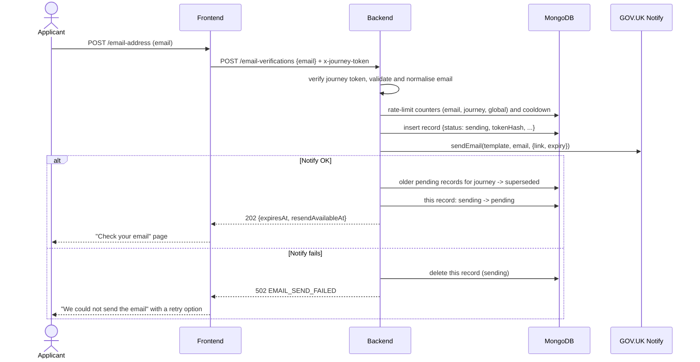
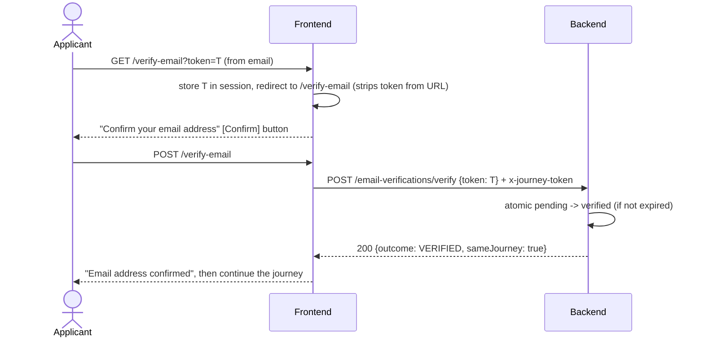
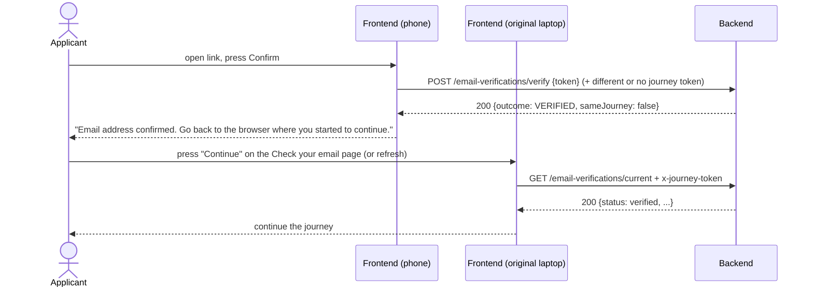

# Email Verification (Magic Link): API and Design

|             |                                                                                                                                                                                                                                                       |
| ----------- | ----------------------------------------------------------------------------------------------------------------------------------------------------------------------------------------------------------------------------------------------------- |
| **Service** | pesticides-ocr-backend (API), pesticides-ocr-frontend (journey pages)                                                                                                                                                                                 |
| **Jira**    | Parent: _Implement Magic Link Email Verification for External Users_. Replaces the OTP design in EQ-445 (closed PR [DEFRA/pesticides-ocr-backend#19](https://github.com/DEFRA/pesticides-ocr-backend/pull/19)); the design change is logged in EQ-549 |
| **Status**  | Draft, for review                                                                                                                                                                                                                                     |
| **Author**  | Saranya Vinayagam                                                                                                                                                                                                                                     |

---

## 1. Purpose and scope

This feature lets an applicant on the OCR Register journey prove they own the email address they entered. It does this by emailing a single-use, time-limited link (a "magic link") through GOV.UK Notify. Following the link marks that email address as verified for the current journey, and the applicant can then complete their submission.

**In scope:** requesting a link, resending it, verifying it, checking verification status, and requiring a verified email when the registration is submitted.

**Out of scope:** authentication, sign-in, accounts, identity management, access to existing registrations, and resuming earlier submissions. A successful verification issues **no** session, cookie or token. It only records that a particular journey and email address pair has been verified.

---

## 2. Glossary

| Term                    | Meaning                                                                                                                                                                                                                          |
| ----------------------- | -------------------------------------------------------------------------------------------------------------------------------------------------------------------------------------------------------------------------------- |
| **Journey**             | One applicant's run through the frontend, identified by the frontend's server-side session (`@hapi/yar`, Redis, 4-hour TTL)                                                                                                      |
| **Journey token**       | The signed per-session token the frontend already creates for the EQ-472 metrics beacons. Its format is `<uuid-nonce>.<hmac-sha256-hex>`, signed with the shared `JOURNEY_TOKEN_SECRET` and sent in the `x-journey-token` header |
| **Journey ID**          | The verified nonce from the journey token. It is what binds a verification to a journey                                                                                                                                          |
| **Link token**          | The secret in the magic link: 32 random bytes, encoded as base64url (43 characters). Only its SHA-256 hash is stored                                                                                                             |
| **Verification record** | One document per link that has been issued (see §6)                                                                                                                                                                              |

---

## 3. Key design decisions

| #   | Decision                                                                                                                                                                                                                    | Rationale                                                                                                                                                                                                                                                           |
| --- | --------------------------------------------------------------------------------------------------------------------------------------------------------------------------------------------------------------------------- | ------------------------------------------------------------------------------------------------------------------------------------------------------------------------------------------------------------------------------------------------------------------- |
| D1  | **The magic link replaces OTP.** The OTP endpoints in PR #19 are not carried forward                                                                                                                                        | Requirement change (EQ-549)                                                                                                                                                                                                                                         |
| D2  | **Verifications are bound to the journey token, not to an ID returned by the API.** No `verificationId` is ever exposed                                                                                                     | Removes the PR #19 problem where a guessable ObjectId plus a returned email address let someone resend to, and see, another person's address. It also reuses a mechanism we already have, as the review suggested (per-session caps using the signed journey token) |
| D3  | **Responses never include the email address**                                                                                                                                                                               | The frontend already knows it (PR #19 review)                                                                                                                                                                                                                       |
| D4  | **The link token is 256 bits from the OS cryptographic random source. Only `sha256(token)` is stored**                                                                                                                      | At 256 bits the token can't be guessed, so no secret or salt is needed for the hash, and a database leak doesn't expose any usable link                                                                                                                             |
| D5  | **Opening the link (GET) does not verify. Verification happens when the user presses a "Confirm email address" button (POST)**                                                                                              | Email security scanners (Outlook Safe Links, Mimecast and others) open links automatically and would otherwise use up a single-use token before the user clicks it                                                                                                  |
| D6  | **Every state change is a single atomic conditional update** (`findOneAndUpdate` with the full precondition in the filter)                                                                                                  | PR #19 review: the read-then-write races in confirm and resend                                                                                                                                                                                                      |
| D7  | **The insert, the email send and the status change can always be reconciled.** A record is inserted as `sending`, the email is sent, and only then is the record set to `pending`. If the send fails, the record is deleted | PR #19 review: "the fix isn't ordering, it's making the two operations reconcilable"                                                                                                                                                                                |
| D8  | **A resend creates a new record and marks every older `pending` record for that journey as `superseded`.** Existing records are never re-keyed                                                                              | Avoids the PR #19 resend rollback problem, and gives "superseded" links a clear message of their own (AC 9)                                                                                                                                                         |
| D9  | **No per-IP rate limiting.** Limits are per email address, per journey, plus a global cap and a resend cooldown                                                                                                             | CDP confirmed that the original client IP isn't exposed to services (PR #19 thread). The global cap protects the Notify quota                                                                                                                                       |
| D10 | **The fix to `notify.js` goes into the shared service, as part of the first magic-link PR.** It must reject on failure and guard the shape of the error. The commit message and PR description must call it out             | PR #19 review (yfeng26): fix it at the source rather than working around it in the caller. The same fix covers the existing `registration.js` caller                                                                                                                |
| D11 | **Fail closed** when `JOURNEY_TOKEN_SECRET` or the Notify template isn't configured. A warning is logged at boot                                                                                                            | PR #19 review: the hash secret defaulted to `''` with no check at start-up                                                                                                                                                                                          |
| D12 | **`POST /register` requires a verified email for the submitted journey and email address**                                                                                                                                  | AC 11 and 12. In PR #19, `/register` was deliberately left ungated, so the check only happened in the frontend session                                                                                                                                              |

---

## 4. Journey binding (answers "is there a stable journeyId?")

**What exists today** (verified in code):

- The frontend's `src/server/common/helpers/journey-beacon.js` creates `journeyToken = <randomUUID>.<HMAC>` the first time it is needed in a session, and stores it in `yar`. It stays the same for the whole session: the server-side cache TTL and cookie TTL are both 4 hours (`SESSION_CACHE_TTL` and `SESSION_COOKIE_TTL`).
- The backend's `src/services/metrics/helpers/journey-token.js#verifiedNonce` already checks it.
- **Gaps:**
  - The token is created lazily and only when `JOURNEY_TOKEN_SECRET` is set.
  - `sessionToken()` isn't exported.
  - The token isn't sent to `/register`.

**Changes needed:**

| Repo     | Change                                                                                                                                                                                                                                            |
| -------- | ------------------------------------------------------------------------------------------------------------------------------------------------------------------------------------------------------------------------------------------------- |
| frontend | Export a `getJourneyToken(request)` helper (the existing `sessionToken` logic) and call it on the email-address page, so a token always exists before verification starts                                                                         |
| frontend | Send `x-journey-token` on every email-verification call and on `POST /register`                                                                                                                                                                   |
| backend  | Add a shared `requireJourneyId(request)` helper (based on the existing `beaconRoute` check) that returns the nonce or throws a 401. It **fails closed**: unlike the beacons, it does not let unsigned requests through when the secret is missing |
| both     | Set `JOURNEY_TOKEN_SECRET` on every tier, including local (`.env.example` gets a development-only value)                                                                                                                                          |

The journey ID is the nonce. It is a random UUID that contains no personal data.

---

## 5. Flows

### 5.1 Request a link (same device)



### 5.2 Verify (link opened in the same browser)



### 5.3 Verify on a different device or browser

The browser that opens the link has its own session (or none), so its journey token doesn't match, or isn't there at all. Verification **still succeeds**, because owning the inbox is what's being proved. The verification is recorded against the _original_ journey stored on the record.



### 5.4 Resend

The frontend calls `POST /email-verifications` again, with the same email address or a new one. The backend creates a new link and supersedes the earlier ones (§5.1). Opening an earlier link then returns `TOKEN_SUPERSEDED`.

### 5.5 Changing the email address after verification

The frontend clears its verification state and calls `POST /email-verifications` with the new address. The latest record for the journey now belongs to the new address, so `GET /current` reports `pending`, and `POST /register` with the new address returns `403 EMAIL_NOT_VERIFIED` until the new address is verified (AC 12).

---

## 6. Data model

**Collection:** `ocr-email-verifications` (the constant is added to `src/common/constants/collections.js`, which is the single source of truth, as the PR #19 review asked)

| Field          | Type         | Notes                                                                                                                                                                            |
| -------------- | ------------ | -------------------------------------------------------------------------------------------------------------------------------------------------------------------------------- |
| `_id`          | ObjectId     | Internal only. **Never** returned by the API, put in links, or written to logs                                                                                                   |
| `journeyId`    | string       | The verified nonce from the journey token                                                                                                                                        |
| `email`        | string       | Trimmed and lower-cased. Plus and dot variants are **not** collapsed, because they are legitimately different addresses; the per-journey and global caps cover abuse of variants |
| `tokenHash`    | string       | `sha256(linkToken)` as hex                                                                                                                                                       |
| `status`       | enum         | `sending` \| `pending` \| `verified` \| `superseded`                                                                                                                             |
| `createdAt`    | Date         |                                                                                                                                                                                  |
| `expiresAt`    | Date         | `createdAt + LINK_TTL`                                                                                                                                                           |
| `verifiedAt`   | Date \| null | Set when the link is verified                                                                                                                                                    |
| `supersededAt` | Date \| null | Set when a newer link replaces it                                                                                                                                                |
| `purgeAt`      | Date         | `createdAt + RECORD_RETENTION`. TTL index with `expireAfterSeconds: 0`                                                                                                           |

**Indexes** (only the ones that a query actually uses, per the PR #19 review about an unused index):

| Index                             | Used by                                   |
| --------------------------------- | ----------------------------------------- |
| `{ tokenHash: 1 }` unique         | verify                                    |
| `{ journeyId: 1, createdAt: -1 }` | current status, supersede, register check |
| `{ purgeAt: 1 }` TTL              | clean-up                                  |

**Collection:** `ocr-email-verification-rate-limits`. This is a fixed-window counter: `{ _id: <bucketKey>, count, windowEndsAt }`, with a TTL on `windowEndsAt`. Each counter is incremented atomically with `findOneAndUpdate` + `$inc` + `upsert`. Bucket keys hash the email with HMAC, so no plain-text address is stored in this collection.

### 6.1 Record state machine

```
              send OK                 verify (in time)
 [sending] ───────────▶ [pending] ─────────────────────▶ [verified]
     │                      │
     │ send fails           │ newer link issued for the same journey
     ▼                      ▼
  (deleted)            [superseded]

 "expired" is not a stored status. It is derived from pending + expiresAt <= now.
```

---

## 7. API reference

**Common to all endpoints**

- Base path: backend service root. These endpoints are **public**, with no Entra bearer token, because the applicant journey has none. The journey token provides anti-forgery and the binding.
- Content type: `application/json`.
- The request body limit is 1 KB, and Joi validation rejects unknown keys.
- Errors use the standard Boom shape, plus a stable machine-readable `code`:

```json
{
  "statusCode": 429,
  "error": "Too Many Requests",
  "message": "Too many verification emails have been requested. Try again later.",
  "code": "RATE_LIMITED"
}
```

The frontend must branch on `code`, never on `message`.

- `x-journey-token` (header, **required** unless marked optional): the frontend's signed per-session token. If it's missing or invalid, the response is `401 JOURNEY_TOKEN_INVALID`.

---

### 7.1 `POST /email-verifications` (request or resend a link)

This endpoint sends a new magic link to `email` for the current journey, and supersedes any earlier pending links for that journey. The **same endpoint is used for a first request and for a resend**.

**Headers:** `x-journey-token` (required)

**Request body**

| Field   | Type   | Rules                                                                                                                                       |
| ------- | ------ | ------------------------------------------------------------------------------------------------------------------------------------------- |
| `email` | string | Required. Trimmed, at most 254 characters, validated with Joi `email({ tlds: false })` (the same limit as `MAX_EMAIL` in `registration.js`) |

```json
{ "email": "jane.smith@example.com" }
```

**Response `202 Accepted`**

```json
{
  "expiresAt": "2026-10-15T10:15:00.000Z",
  "resendAvailableAt": "2026-10-15T10:01:00.000Z"
}
```

| Field               | Meaning                                                                                                                                 |
| ------------------- | --------------------------------------------------------------------------------------------------------------------------------------- |
| `expiresAt`         | When the link stops working. The frontend shows "The link will expire in 15 minutes"                                                    |
| `resendAvailableAt` | The earliest time the next request will be accepted (the cooldown). The frontend can use it to show when "Send another email" will work |

The response includes **no** email address, token or ID.

**Errors**

| HTTP | `code`                   | When                                                                                                                                                                                                   | Frontend behaviour                                                                                 |
| ---- | ------------------------ | ------------------------------------------------------------------------------------------------------------------------------------------------------------------------------------------------------ | -------------------------------------------------------------------------------------------------- |
| 400  | `VALIDATION_ERROR`       | Email missing or invalid, or there are unknown fields                                                                                                                                                  | Show a GOV.UK error summary: "Enter an email address in the correct format, like name@example.com" |
| 401  | `JOURNEY_TOKEN_INVALID`  | Header missing, malformed or forged                                                                                                                                                                    | Show the error page (this shouldn't happen in normal use)                                          |
| 429  | `RESEND_COOLDOWN`        | Within the cooldown since this journey's last send. Sets a `Retry-After` header                                                                                                                        | "Wait N seconds before requesting another email"                                                   |
| 429  | `RATE_LIMITED`           | The per-email, per-journey or global cap was hit. Sets a `Retry-After` header. The same code is used for every cap, so the response doesn't reveal which one, or anything about another user's address | "You have requested too many emails. Try again in N minutes."                                      |
| 502  | `EMAIL_SEND_FAILED`      | Notify rejected the send or was unreachable. No record is left behind and no quota is used (see §8)                                                                                                    | "We could not send the email. Check the address is correct and try again."                         |
| 503  | `SERVICE_NOT_CONFIGURED` | The journey token secret, Notify key or template ID is missing on this tier                                                                                                                            | Show the error page                                                                                |

**Order of processing** (this matters for the counters and for reconciliation):

1. Validate the body and the journey token.
2. Check the cooldown. This is atomic: it is part of the counter update for the journey's bucket.
3. Increment the counters: the email bucket, the journey bucket and the global bucket. If any is over its limit, return 429, and **give back** the increments already made (`$inc: -1`) so that a refused request doesn't use up quota.
4. Insert the record with `status: 'sending'`.
5. Send through Notify. On failure: delete the record, give back the counters, and return 502.
6. Mark the journey's other `pending` records as `superseded` (`updateMany`).
7. Set this record from `sending` to `pending`. This is conditional on `status: 'sending'`.
8. Write the audit event `EMAIL_VERIFICATION_LINK_SENT` and return 202.

If the process crashes between steps 6 and 7, the safe outcome is that no link works, and the applicant just presses resend. Two links can never both be live. The `sending` record is purged by the TTL.

---

### 7.2 `GET /email-verifications/current` (status for this journey)

This endpoint returns the verification state of the journey's latest link. The original browser uses it to continue after the applicant verifies on another device. The email address is **not** passed in the URL, so no personal data appears in query strings.

**Headers:** `x-journey-token` (required)

**Response `200 OK`**

```json
{
  "status": "verified",
  "expiresAt": "2026-10-15T10:15:00.000Z",
  "verifiedAt": "2026-10-15T10:03:12.000Z",
  "resendAvailableAt": "2026-10-15T10:01:00.000Z"
}
```

| `status`   | Meaning                                                                                         |
| ---------- | ----------------------------------------------------------------------------------------------- |
| `none`     | No link has been requested in this journey                                                      |
| `pending`  | The latest link has been sent and is still valid                                                |
| `expired`  | The latest link has passed `expiresAt` without being verified                                   |
| `verified` | The latest requested email address has a verified record, and it is still within `VERIFIED_TTL` |

The frontend must compare this against the email address held in its own session. If the applicant has changed the address since the last request, the frontend must call §7.1 again; it can't rely on this endpoint for the new address.

**Errors:** `401 JOURNEY_TOKEN_INVALID`.

---

### 7.3 `POST /email-verifications/verify` (consume a link)

This endpoint is called by the frontend when the applicant presses **Confirm** on the landing page. It is **not** called when the GET landing page loads (decision D5).

**Headers:** `x-journey-token` (**optional**). If present and valid, it is used only to work out `sameJourney`. If it's missing, or belongs to a different session, verification still succeeds, which allows the cross-device case.

**Request body**

| Field   | Type   | Rules                                                                                                                                        |
| ------- | ------ | -------------------------------------------------------------------------------------------------------------------------------------------- |
| `token` | string | Required. Exactly 43 characters of base64url (`^[A-Za-z0-9_-]{43}$`). Anything else returns `TOKEN_INVALID`, and the database is not queried |

**Response `200 OK`**

```json
{ "outcome": "VERIFIED", "sameJourney": true }
```

**Logic:**

1. Do a single atomic update:

   ```js
   findOneAndUpdate(
     { tokenHash, status: 'pending', expiresAt: { $gt: now } },
     { $set: { status: 'verified', verifiedAt: now } },
     { returnDocument: 'after' }
   )
   ```

   Concurrent clicks therefore produce exactly one success.

2. If nothing matched, read by `tokenHash` to choose the right error. This read happens only after the atomic update has already failed, so it can't let an attempt succeed.

**Errors**

| HTTP | `code`                | When                                                                                                         | Message shown to the applicant (AC 10)                                                                    |
| ---- | --------------------- | ------------------------------------------------------------------------------------------------------------ | --------------------------------------------------------------------------------------------------------- |
| 400  | `TOKEN_INVALID`       | Token is malformed                                                                                           | "This link is not valid. Check you used the full link from the most recent email, or request a new one."  |
| 404  | `TOKEN_INVALID`       | No record has this hash, or it was purged                                                                    | _(same as above)_                                                                                         |
| 410  | `TOKEN_EXPIRED`       | Status is `pending` and `expiresAt <= now`                                                                   | "This link has expired. Links work for 15 minutes." [Send a new link]                                     |
| 410  | `TOKEN_SUPERSEDED`    | Status is `superseded`                                                                                       | "This link has been replaced by a newer one. Use the link in the most recent email we sent you."          |
| 409  | `TOKEN_ALREADY_USED`  | Status is `verified`. The body includes `sameJourney`. If it's `true`, the frontend continues as if verified | "This email address has already been confirmed." [Continue] or "Go back to the browser where you started" |
| 500  | `VERIFICATION_FAILED` | Unexpected error                                                                                             | "Sorry, there is a problem with the service. Try again later."                                            |

The frontend shows the same message for a malformed token and an unknown one, because the applicant can't do anything different about either.

---

### 7.4 `POST /register` (existing endpoint, changed)

**New requirement:** an `x-journey-token` header. Before saving, the backend checks that there is a record with:

- `journeyId` matching the journey token,
- `email` equal to `contact.email` from the submission (normalised),
- `status: 'verified'`, and
- `verifiedAt` later than `now - VERIFIED_TTL`.

| HTTP | `code`                  | When                                                                                                                                                                                                     |
| ---- | ----------------------- | -------------------------------------------------------------------------------------------------------------------------------------------------------------------------------------------------------- |
| 401  | `JOURNEY_TOKEN_INVALID` | The header is missing or invalid                                                                                                                                                                         |
| 403  | `EMAIL_NOT_VERIFIED`    | No matching verified record: the email was never verified, it was verified on another journey, it changed after verification, or the verification is too old. The frontend redirects to `/email-address` |

The existing `201` response and validation behaviour stay the same. Validation runs first, so an invalid payload is still a `400`. A missing `JOURNEY_TOKEN_SECRET` is `503 SERVICE_NOT_CONFIGURED`. A refusal emits `REGISTRATION_EMAIL_NOT_VERIFIED` and the `registrationEmailNotVerified` counter.

**Rollout:** the backend and frontend deploy separately, so `EMAIL_VERIFICATION_REQUIRED_FOR_REGISTRATION` (default `true`) lets a tier turn this check off, header included, until its frontend sends `x-journey-token` on `/register`. Tiers other than `local` log a boot warning while it is `false`.

---

## 8. GOV.UK Notify integration

| Item            | Value                                                                                                                                                                                                                               |
| --------------- | ----------------------------------------------------------------------------------------------------------------------------------------------------------------------------------------------------------------------------------- |
| Template key    | `emailVerificationLink`, held in `notify.templates`. Config env var `NOTIFY_TEMPLATE_EMAIL_VERIFICATION_LINK`. **The default is `''`**, matching `submissionConfirmation`; real template IDs are set per environment, never in code |
| Personalisation | `verification_link` (the full HTTPS URL) and `expiry_minutes` (for example `15`). Nothing else: no names and no submission data                                                                                                     |
| `reference`     | Not set. A per-send reference could link back to the record; we don't need that, and leaving it out means nothing joins Notify's logs to ours                                                                                       |
| Keys            | Local and development use `NOTIFY_KEY_MODE=team`, so email goes only to the guest list, or `test`, so nothing is delivered. The team owns the service. Going live needs a **live** key, requested as a CDP secret per tier          |
| Link format     | `${EMAIL_VERIFICATION_LINK_BASE_URL}/verify-email?token=<43-char token>`. The config is validated as `https://` everywhere except `cdpEnvironment === 'local'`                                                                      |

**Suggested template content** (for the content designer to review):

> Subject: Confirm your email address
>
> Use this link to confirm your email address for the Pesticides Officially Controlled Register:
>
> ((verification_link))
>
> The link will expire in ((expiry_minutes)) minutes and can only be used once.
>
> If you did not ask for this, you can ignore this email.

**`notify.js` changes. These are delivered in the first magic-link PR (D10) and called out in its commit message and description:**

1. `sendEmail` must **reject** on failure. Today it resolves with the Error object, so callers can't tell that the send failed.
2. Guard the error shape: `error.response?.data?.errors ?? {}`. Network errors and timeouts have no `.response`, and the current code throws a TypeError inside its own `catch`, which hides the original error.
3. Replace the `console.log` and `console.error` calls with the pino logger. Never log the email address or the personalisation (the link).
4. Add tests that use Notify's real failure shapes: a 400 with `response.data.errors`, and a plain `new Error('ECONNREFUSED')`.
5. Check for existing callers. As of `feature/BE-549`, nothing else calls `sendEmail`; `registration.js` doesn't send email. Any future caller must handle the rejection.

---

## 9. Rate limiting and abuse protection

All values are interim standard values, to be confirmed with the team. They are all configurable and validated as `positive-int`, so a zero can't be set by accident (PR #19 review).

| Limit                   | Default        | Key                                                                                                                             |
| ----------------------- | -------------- | ------------------------------------------------------------------------------------------------------------------------------- |
| Sends per email address | 5 per hour     | `hmac(email)`                                                                                                                   |
| Sends per journey       | 5 per hour     | `journeyId`                                                                                                                     |
| Resend cooldown         | 60 s           | `journeyId`                                                                                                                     |
| Global sends            | 1,000 per hour | `global`. This protects the Notify quota and the cost of sending. Size it against peak expected volume (NFR 5)                  |
| Verify attempts         | Not limited    | A 256-bit token can't be guessed by brute force. A body size cap and format check are enough. Revisit if monitoring shows abuse |

**Not used:** per-IP limiting, because CDP doesn't expose the client IP (D9).

**Known residual risk:** someone who mints their own sessions could request up to 5 emails per hour to a victim's address. That is the per-email cap, and it is how comparable GOV.UK services behave. The email says "If you did not ask for this, you can ignore this email".

---

## 10. Configuration

All settings use convict with `#/…js` alias imports, following the existing `config.js` pattern. Every value that has a default must have the same value in `.env.example`.

| Key (env var)                                       | Format                   | Default        | Notes                                                                                                                      |
| --------------------------------------------------- | ------------------------ | -------------- | -------------------------------------------------------------------------------------------------------------------------- |
| `EMAIL_VERIFICATION_LINK_TTL_SECONDS`               | positive-int             | `900` (15 min) | Agreed                                                                                                                     |
| `EMAIL_VERIFICATION_VERIFIED_TTL_SECONDS`           | positive-int             | `14400` (4 h)  | How long a verification counts towards `/register`. It matches the frontend session TTL. **To be confirmed with the team** |
| `EMAIL_VERIFICATION_RECORD_RETENTION_SECONDS`       | positive-int             | `86400` (24 h) | Must be at least `VERIFIED_TTL` (checked at start-up)                                                                      |
| `EMAIL_VERIFICATION_RESEND_COOLDOWN_SECONDS`        | positive-int             | `60`           |                                                                                                                            |
| `EMAIL_VERIFICATION_MAX_SENDS_PER_EMAIL_PER_HOUR`   | positive-int             | `5`            |                                                                                                                            |
| `EMAIL_VERIFICATION_MAX_SENDS_PER_JOURNEY_PER_HOUR` | positive-int             | `5`            |                                                                                                                            |
| `EMAIL_VERIFICATION_MAX_SENDS_GLOBAL_PER_HOUR`      | positive-int             | `1000`         |                                                                                                                            |
| `EMAIL_VERIFICATION_LINK_BASE_URL`                  | url (https except local) | `''`           | The frontend's public origin, set per environment                                                                          |
| `EMAIL_VERIFICATION_HASH_SECRET`                    | String, sensitive        | `''`           | HMAC key for email hashes in rate-limit keys and audit records. A boot warning if it's missing; requests return 503        |
| `NOTIFY_TEMPLATE_EMAIL_VERIFICATION_LINK`           | String                   | `''`           | Set per environment                                                                                                        |
| `EMAIL_VERIFICATION_REQUIRED_FOR_REGISTRATION`      | Boolean                  | `true`         | Rollout flag for the `/register` gate (§7.4). Boot warning off `local` while `false`                                       |
| `JOURNEY_TOKEN_SECRET`                              | String, sensitive        | `''`           | Already exists. It now becomes **required** for verification (fail closed, D11)                                            |

The boot check follows the existing `warnIfJourneyTokenUnset` pattern. It logs a warning for each missing secret or template on any tier other than `local`.

---

## 11. Logging, audit and monitoring

**Never logged:** link tokens, token hashes, verification URLs, full email addresses, or the Notify personalisation. When an address has to be referred to, use a masked form (`j***@example.com`) or the HMAC hash.

- **Request logging:** the token travels in the POST **body** to the backend, not in a URL. Check that `hapi-pino` doesn't log request bodies, and add `req.body.token` and `req.body.email` to the `log.redact` paths as a safeguard.
- **Frontend:** the landing page's GET URL contains the token, so the frontend and CDP ingress access logs will record it. To limit this:
  1. The frontend immediately moves the token into the session and redirects to a URL without it.
  2. It sets `Referrer-Policy: no-referrer` on that page.
  3. The token works once and expires after 15 minutes.
  4. Only its hash is stored.

  Ask the CDP team whether query strings can be dropped from ingress logs for `/verify-email`.

**Audit events** (through `@defra/cdp-auditing`). Every event carries `journeyId`, `emailHash` and `timestamp`.

| Event                                 | Extra fields                                                                                                     |
| ------------------------------------- | ---------------------------------------------------------------------------------------------------------------- |
| `EMAIL_VERIFICATION_LINK_REQUESTED`   |                                                                                                                  |
| `EMAIL_VERIFICATION_LINK_SENT`        | `expiresAt`                                                                                                      |
| `EMAIL_VERIFICATION_LINK_SEND_FAILED` | `reason` (a Notify error category, not the raw error)                                                            |
| `EMAIL_VERIFICATION_RATE_LIMITED`     | `limit` (`email` \| `journey` \| `global` \| `cooldown`). Recorded internally only, never returned to the caller |
| `EMAIL_VERIFICATION_VERIFIED`         | `sameJourney`                                                                                                    |
| `EMAIL_VERIFICATION_REJECTED`         | `code` (`TOKEN_EXPIRED`, …)                                                                                      |
| `REGISTRATION_EMAIL_NOT_VERIFIED`     |                                                                                                                  |

**Metrics** (through `@defra/cdp-metrics`):

- `emailVerificationLinkSent`
- `emailVerificationSendFailed`
- `emailVerificationRateLimited`
- `emailVerificationVerified`
- `emailVerificationRejected`, with an outcome dimension

Proposed alerts:

- the Notify failure rate is above 5% over 15 minutes;
- the global cap is reached.

---

## 12. Security summary

| Threat                                                    | Mitigation                                                                                                         |
| --------------------------------------------------------- | ------------------------------------------------------------------------------------------------------------------ |
| Guessing a link                                           | 256-bit token, single use, 15-minute expiry                                                                        |
| Database leak exposes links                               | Only `sha256(token)` is stored                                                                                     |
| Exposing someone else's address                           | No email or ID in responses. Verifications are tied to a signed per-session token, not to an ID the client chooses |
| Replay or double use                                      | Atomic `pending → verified`; concurrent attempts produce exactly one success                                       |
| Old link used after a resend                              | `superseded` status, set before the new link becomes `pending`                                                     |
| Email-scanner prefetch                                    | The GET page shows a confirm button; only the POST consumes the token                                              |
| Inbox flooding and Notify quota exhaustion                | Per-email, per-journey and global caps, plus a cooldown                                                            |
| Forged backend calls                                      | HMAC-signed journey token, failing closed                                                                          |
| Token leaks in logs or the referrer                       | POST body, redact paths, redirect to strip the token, `no-referrer`                                                |
| Transport                                                 | HTTPS-only links, validated in config                                                                              |
| Bypassing verification by posting to `/register` directly | The backend requires a verified record (§7.4)                                                                      |

---

## 13. Accessibility and cross-device guidance (frontend)

- Use the GOV.UK Design System **"Confirm an email address"** pattern for the check-your-email page.
- The check-your-email page shows:
  - the address the email was sent to, with a "Change" link;
  - the expiry time;
  - a "Not received an email?" details component that suggests checking spam and offers a resend;
  - a sentence covering the cross-device case: "If you open the link on a different device, come back to this page and select Continue."
- Every outcome page has an `h1`, a clear next action, and no time-based auto-redirect (WCAG 2.2.1).
- The pages meet WCAG 2.2 AA, checked with axe and a manual check using keyboard, NVDA and VoiceOver.

---

## 14. Test plan (Definition of Done)

Repository and query logic runs against the **real in-memory Mongo** (`.vite/mongo-memory-server.js`) rather than hand-written fakes, so the conditional filters are actually exercised (PR #19 review).

| Scenario                                                                                                                                   | Level                         |
| ------------------------------------------------------------------------------------------------------------------------------------------ | ----------------------------- |
| Request → verify succeeds (same journey)                                                                                                   | route + E2E                   |
| Verify from another device (`sameJourney: false`), then `/current` returns verified                                                        | route + E2E                   |
| Malformed or unknown token → `TOKEN_INVALID`                                                                                               | unit + route                  |
| Expired token → `TOKEN_EXPIRED` (use fake timers or a short TTL)                                                                           | route                         |
| Reused token → `TOKEN_ALREADY_USED`                                                                                                        | route                         |
| Resend → old link `TOKEN_SUPERSEDED`, new link verifies                                                                                    | route + E2E                   |
| **Concurrency:** `Promise.all` of 10 verifies with the same token gives exactly one `VERIFIED`                                             | integration (in-memory Mongo) |
| **Concurrency:** parallel resends give at most one live `pending` record, and the counters are correct                                     | integration                   |
| **Concurrency:** a verify racing a resend leaves a consistent final state (either the old link is verified or it's superseded, never both) | integration                   |
| Notify failure (400 shape and network-error shape) → 502, no record left, counters given back                                              | unit + route                  |
| Each rate limit and the cooldown → 429 with `Retry-After`, no email sent                                                                   | route                         |
| Rate-limit window resets                                                                                                                   | integration                   |
| Missing or forged journey token → 401; missing secret → 503                                                                                | route                         |
| `/register`: unverified, other journey, changed email, stale verification → 403; verified → 201                                            | route                         |
| Logs contain no token, URL or full email address                                                                                           | unit (assert on logger calls) |
| Audit events emitted for every action                                                                                                      | unit                          |
| Config: `positive-int` rejects 0; HTTPS enforced off `local`; boot warnings                                                                | unit                          |
| Accessibility and cross-browser journey                                                                                                    | manual + axe                  |
| Load: request and verify at expected peak                                                                                                  | performance                   |

---

## 15. Engineering checklist (lessons from the PR #19 review)

These apply to every PR for this feature:

- [ ] Every check-then-write is a **single conditional atomic update**. There are no read-then-`$set` updates on counters or status.
- [ ] DB writes and the Notify send can always be **reconciled** if either one fails.
- [ ] No email addresses, guessable IDs or tokens appear in API responses.
- [ ] Notify errors are handled at the source (`notify.js`) and tested with real error shapes.
- [ ] Collection names come only from `src/common/constants/collections.js`.
- [ ] Shared HTTP status constants are used (add `src/common/constants/http-status.js`; don't redeclare `HTTP_CREATED` in each file).
- [ ] Imports use the `#/…js` alias, with the extension.
- [ ] Numeric config uses `positive-int`; secrets have a boot-time check; there are **no environment-specific defaults** in code (template IDs default to `''`).
- [ ] `.env.example` matches the code defaults.
- [ ] Only indexes that a query uses.
- [ ] Tests run against in-memory Mongo, including `Promise.all` concurrency tests.
- [ ] Comments explain the code, not the repo or tooling around it.
- [ ] README: **one** endpoint table, and the documented responses match the code. Any linked design doc is committed.
- [ ] Unrelated changes (tooling, test infrastructure, `cross-env`) go in a separate small PR.
- [ ] The PR description matches what the code does, and includes changes to shared modules such as `notify.js` and new config keys.
- [ ] Push before marking review threads as resolved. Squash to a conventional commit, for example `feat(email-verification): add magic link request/verify endpoints (EQ-xxx)`.

---

## 16. Open items

| #   | Item                                                                | Owner            | Interim                                        |
| --- | ------------------------------------------------------------------- | ---------------- | ---------------------------------------------- |
| 1   | Final rate-limit thresholds                                         | Team             | §9 defaults                                    |
| 2   | How long a verification stays valid for submission (`VERIFIED_TTL`) | Team / business  | 4 hours (frontend session TTL)                 |
| 3   | Live Notify API key for production                                  | Saranya          | Use the team/test keys on non-production tiers |
| 4   | Whether CDP ingress can drop query strings for `/verify-email`      | CDP support      | The redirect strips the token                  |
| 5   | Content design sign-off for the email and outcome pages             | Content designer | §8 and §7.3 wording                            |
| 6   | Security sign-off                                                   | Security         | This document                                  |

---

## 17. Suggested delivery sequence

All backend work goes on `feature/BE-549`, and all frontend work on `feature/FE-549`. Each step below becomes one reviewed commit on that branch, and nothing is committed or pushed without explicit approval. Where several writes must happen together (for example superseding older links and activating the new one in §7.1), use `withTransaction` from `src/repositories/mongo-transaction.js` (EQ-535).

1. `feat(email-verification): records, token service and config`. Covers MLV-1 and also includes the `notify.js` fix (D10). The commit message body must state that `sendEmail` now rejects on failure, guards the error shape and no longer logs email addresses, and that `registration.js` was updated to keep its confirmation email best-effort.
2. `feat(email-verification): request and resend endpoint with rate limiting`. Covers MLV-2 and MLV-4.
3. `feat(email-verification): verify and current-status endpoints`. Covers MLV-3.
4. `feat(register): require verified email for journey`. Covers MLV-6. Deploy after the frontend sends `x-journey-token` on `/register`, or put it behind a feature flag.
5. Frontend PRs: replace the OTP pages (`/email-address/code`, `/resend`) with the check-your-email and `/verify-email` pages.

Sequence of calls across frontend pages (per the design doc, §5 and §7.4)

1. /email-address page (type address, submit)
   → POST /email-verifications (send link, get expiresAt/resendAvailableAt)

2. /check-your-email page (waiting screen)
   → (optional/background) GET /email-verifications/current (poll for cross-device verification)
   → "Send another email" button re-triggers POST /email-verifications (resend, subject to cooldown)

3a. Same-device path:
User opens link → GET lands on /verify-email?token=T (frontend only strips the token into session,
does NOT call the backend GET — per D5, opening the link must not verify)
→ redirect to /verify-email (no token in URL)
→ user clicks "Confirm" button
→ POST /email-verifications/verify (consumes the token, returns VERIFIED + sameJourney:true)
→ frontend proceeds in journey

3b. Cross-device path:
User opens link on phone, clicks Confirm
→ POST /email-verifications/verify (no/foreign journey token; sameJourney:false)
User returns to original laptop tab, clicks "Continue" (or page auto-refreshes)
→ GET /email-verifications/current (confirms status: verified for _that_ journey)
→ frontend proceeds in journey

4. Final submission page
   → POST /register (now includes x-journey-token; backend checks a verified record matches
   journeyId + normalised contact email before accepting, §7.4)
